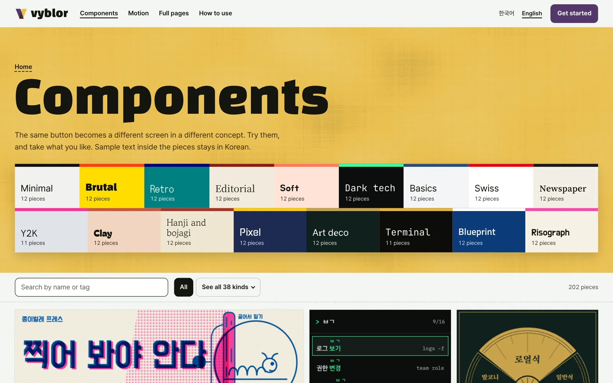
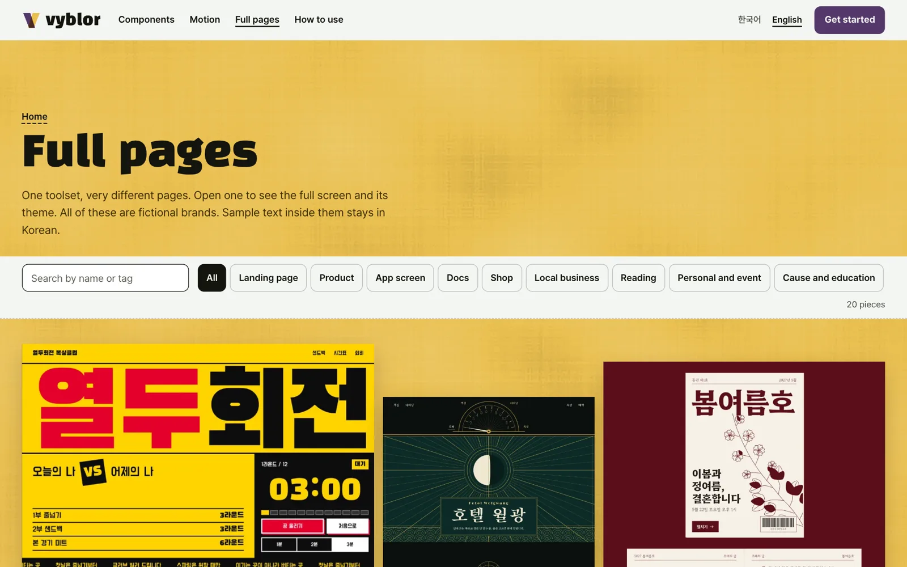

<p align="center">
  <a href="https://vyblor.com/en/components"></a>
</p>

<h1 align="center">Vyblor CLI</h1>

<p align="center"><strong>Vibe coded, and still beautiful.</strong><br>
Find Vyblor components, motion and full pages from your terminal, and save them into your project as files.</p>

<p align="center">
  <a href="README.md">한국어</a> · English
</p>

<p align="center">
  <a href="https://www.npmjs.com/package/vyblor">npm</a> ·
  <a href="https://vyblor.com/en">Website</a> ·
  <a href="https://vyblor.com/en/docs">Docs</a> ·
  <a href="https://github.com/Vyblor/mcp">MCP</a> ·
  <a href="https://github.com/Vyblor/design">Skill</a>
</p>

> This repository holds the guide and the issue tracker. The CLI ships as the npm package [`vyblor`](https://www.npmjs.com/package/vyblor). If something goes wrong, please open an [issue](https://github.com/Vyblor/cli/issues).

## Getting started

You need Node 20 or later and a free [Vyblor account](https://vyblor.com/en/signup). There is nothing to install first.

```sh
npx vyblor login
npx vyblor search button
npx vyblor add minimal-button
```

### 1. Sign in

```sh
npx vyblor login
```

Your account page opens. Create a key under **API keys** and paste it. The key is saved to `~/.config/vyblor/credentials` with mode 600. In CI, set `VYBLOR_API_KEY` instead.

### 2. Find a piece

```sh
npx vyblor search button
npx vyblor list --taxonomy
```

### 3. Bring it in

```sh
npx vyblor add minimal-button
```

By default this saves a React file to `./vyblor/`. You can also take HTML or a prompt, and apply your own brand values.

```sh
npx vyblor add minimal-button --format html
npx vyblor add minimal-button --radius 12px --accent '#54386b'
```

## What you can bring in

| | |
|---|---|
| [](https://vyblor.com/en/components) | [](https://vyblor.com/en/motion) |
| **[Over 200 components](https://vyblor.com/en/components)** | **[Over 140 motion pieces](https://vyblor.com/en/motion)** |
| [](https://vyblor.com/en/pages) | [](https://vyblor.com/en/pages/art-deco-grand-hotel) |
| **[20 full pages](https://vyblor.com/en/pages)** | **[Check colours and fonts in the detail view](https://vyblor.com/en/pages/art-deco-grand-hotel)** |

### See it in use

This is a hotel page built by pasting a Vyblor prompt into Claude Code. The film's captions are in Korean.

<p align="center">
  <a href="https://github.com/Vyblor/design/releases/download/film-2026-11-02/vyblor-threads-intro.mp4"></a><br>
  <a href="https://github.com/Vyblor/design/releases/download/film-2026-11-02/vyblor-threads-intro.mp4">Watch the full film (35 seconds, MP4)</a>
</p>

The run used a prompt copied from the website, and the result was not edited by a person. It is the second of two runs of the same prompt, and the film speeds up the waiting.

## Commands

| Command | What it does |
|---|---|
| `vyblor login` | Sign in with a key from your account page |
| `vyblor logout` | Remove the key from this machine |
| `vyblor whoami` | Show the signed-in account |
| `vyblor search <query>` | Find pieces |
| `vyblor add <slug>` | Save a piece to a file |
| `vyblor list` | Browse pieces; `--taxonomy` shows kind and concept codes |

| Option | Used with | Meaning |
|---|---|---|
| `--format prompt\|html\|react` | `add` | The format to take, `react` by default |
| `--out <path>` | `add` | Where to save |
| `--radius 12px` | `add` | Your corner value |
| `--accent '#54386b'` | `add` | Your accent colour |
| `--force` | `add` | Overwrite an existing file |
| `--type`, `--kind`, `--concept` | `search`, `list` | Narrow the results |
| `--limit`, `--cursor`, `--json` | `search`, `list` | Count, next page, JSON output |
| `--locale ko\|en` | Every command | The language of the content |

Messages follow your system language, Korean or English.

## What `add` will and won't do

- It writes exactly what the server returned, and nothing else.
- It never overwrites a file unless you pass `--force`.
- By default it writes to `./vyblor/` and refuses a path that leaves your project, including through a symbolic link. Naming a path with `--out` is how you write elsewhere on purpose.
- Pieces that need a library such as GSAP name it with an install line and a licence link. That library comes from its own source under its own licence.

## Exit codes

| Code | Meaning |
|---|---|
| `0` | Done |
| `2` | Usage |
| `3` | Sign-in |
| `4` | Rate limit |
| `5` | Not found |
| `6` | Network |
| `7` | File refused |
| `8` | Server |

## Limits

Calls are limited to 60 a minute per key and 120 a minute per account. Fetching pieces is limited to 40 an hour and 100 a day per account, counted across MCP and the CLI. When a limit is reached, the error says when to retry. Bulk downloading is against the [terms](https://vyblor.com/terms).

## Other ways in

| | What it does | Account |
|---|---|---|
| [Skill](https://github.com/Vyblor/design) | Gives your agent design judgement | Not needed |
| [MCP](https://github.com/Vyblor/mcp) | Lets your agent search and fetch the library itself | Needed |

## Licence

The CLI is MIT. Pieces are covered by the [Vyblor terms](https://vyblor.com/terms): free to use in your personal and commercial projects, and not to be redistributed as a library, template, kit or dataset. The screenshots and film in this repository, and the Vyblor name and logo, are not covered by the MIT licence.
