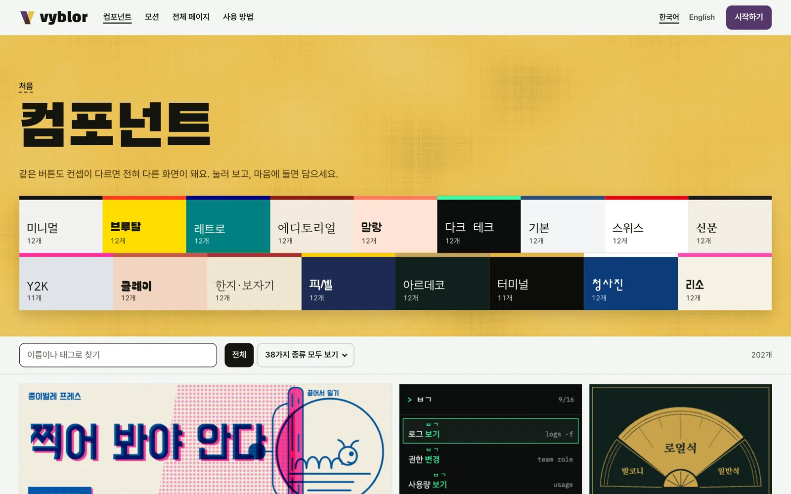
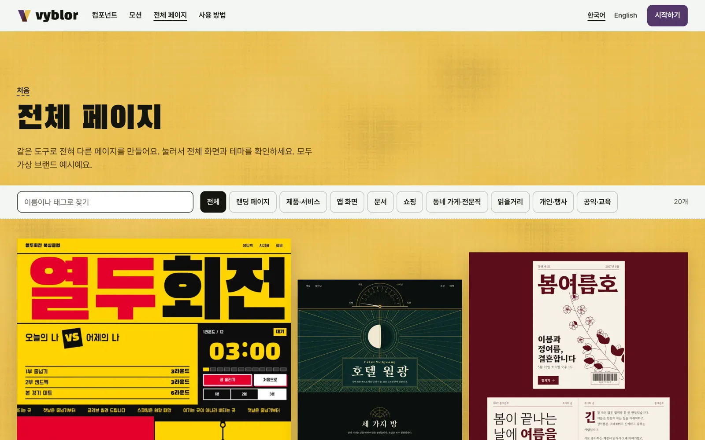
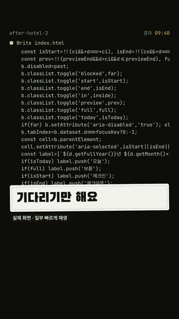

<p align="center">
  <a href="https://vyblor.com/components"></a>
</p>

<h1 align="center">Vyblor CLI</h1>

<p align="center"><strong>바이브 코딩으로도, 예쁘게.</strong><br>
Vyblor의 컴포넌트, 모션, 전체 페이지를 터미널에서 찾아 내 프로젝트에 파일로 저장해요.</p>

<p align="center">
  한국어 · <a href="README.en.md">English</a>
</p>

<p align="center">
  <a href="https://www.npmjs.com/package/vyblor">npm</a> ·
  <a href="https://vyblor.com">웹사이트</a> ·
  <a href="https://vyblor.com/docs">사용 방법</a> ·
  <a href="https://github.com/Vyblor/mcp">MCP</a> ·
  <a href="https://github.com/Vyblor/design">스킬</a>
</p>

> 이 저장소는 안내 문서와 문의 창구예요. CLI 코드는 npm 패키지 [`vyblor`](https://www.npmjs.com/package/vyblor)로 배포돼요. 문제가 있으면 [Issues](https://github.com/Vyblor/cli/issues)에 남겨 주세요.

## 시작하기

Node 20 이상과 무료 [Vyblor 계정](https://vyblor.com/signup)이 필요해요. 설치는 따로 없어요.

```sh
npx vyblor login
npx vyblor search button
npx vyblor add minimal-button
```

### 1. 로그인

```sh
npx vyblor login
```

계정 페이지가 열려요. **API 키**에서 키를 만들어 붙여 넣으면 끝이에요. 키는 `~/.config/vyblor/credentials`에 파일 권한 600으로 저장돼요. CI에서는 `VYBLOR_API_KEY` 환경 변수를 쓰면 돼요.

### 2. 찾기

```sh
npx vyblor search button
npx vyblor list --taxonomy
```

### 3. 가져오기

```sh
npx vyblor add minimal-button
```

기본으로 React 파일을 `./vyblor/`에 저장해요. HTML이나 프롬프트로도 받을 수 있고, 내 브랜드 값을 입혀서 받을 수도 있어요.

```sh
npx vyblor add minimal-button --format html
npx vyblor add minimal-button --radius 12px --accent '#54386b'
```

## 어떤 걸 가져올 수 있나요

| | |
|---|---|
| [](https://vyblor.com/components) | [](https://vyblor.com/motion) |
| **[컴포넌트 200개 이상](https://vyblor.com/components)** | **[모션 140개 이상](https://vyblor.com/motion)** |
| [](https://vyblor.com/pages) | [](https://vyblor.com/pages/art-deco-grand-hotel) |
| **[전체 페이지 20개](https://vyblor.com/pages)** | **[상세 화면에서 색과 글꼴까지 확인](https://vyblor.com/pages/art-deco-grand-hotel)** |

### 실제로 쓰는 모습

Vyblor의 프롬프트를 Claude Code에 붙여 넣어 호텔 페이지를 만든 과정이에요.

<p align="center">
  <a href="https://github.com/Vyblor/design/releases/download/film-2026-11-02/vyblor-threads-intro.mp4"></a><br>
  <a href="https://github.com/Vyblor/design/releases/download/film-2026-11-02/vyblor-threads-intro.mp4">전체 영상 보기 (35초, MP4)</a>
</p>

웹사이트에서 복사한 프롬프트로 실행했고, 결과는 사람이 고치지 않았어요. 같은 프롬프트로 두 번 실행한 것 중 두 번째 결과이고, 기다리는 구간은 빠르게 재생했어요.

## 명령어

| 명령 | 하는 일 |
|---|---|
| `vyblor login` | 계정 페이지에서 만든 키로 로그인해요 |
| `vyblor logout` | 이 컴퓨터에서 키를 지워요 |
| `vyblor whoami` | 로그인한 계정을 보여 줘요 |
| `vyblor search <검색어>` | 조각을 찾아요 |
| `vyblor add <slug>` | 조각을 파일로 저장해요 |
| `vyblor list` | 조각을 둘러봐요. `--taxonomy`는 종류와 컨셉 코드를 보여 줘요 |

| 옵션 | 쓰는 곳 | 뜻 |
|---|---|---|
| `--format prompt\|html\|react` | `add` | 받을 형식, 기본값 `react` |
| `--out <경로>` | `add` | 저장할 위치 |
| `--radius 12px` | `add` | 모서리 값 |
| `--accent '#54386b'` | `add` | 강조 색 |
| `--force` | `add` | 있는 파일을 덮어써요 |
| `--type`, `--kind`, `--concept` | `search`, `list` | 범위 좁히기 |
| `--limit`, `--cursor`, `--json` | `search`, `list` | 개수, 다음 페이지, JSON 출력 |
| `--locale ko\|en` | 모든 명령 | 받는 글의 언어 |

안내 메시지는 시스템 언어에 맞춰 한국어나 영어로 나와요.

## `add`가 하는 일과 하지 않는 일

- 서버가 준 내용만 그대로 저장해요.
- `--force` 없이는 파일을 덮어쓰지 않아요.
- 기본 저장 위치는 `./vyblor/`예요. 심볼릭 링크를 통한 경우를 포함해 프로젝트 밖으로 나가는 경로는 거부해요. 다른 곳에 저장하려면 `--out`으로 직접 지정해 주세요.
- GSAP 같은 라이브러리가 필요한 조각은 설치 줄과 라이선스 링크를 알려 줘요. 그 라이브러리는 자체 출처와 라이선스를 따라요.

## 종료 코드

| 코드 | 뜻 |
|---|---|
| `0` | 완료 |
| `2` | 사용법 오류 |
| `3` | 로그인 필요 |
| `4` | 호출 한도 |
| `5` | 찾을 수 없음 |
| `6` | 네트워크 |
| `7` | 파일 저장 거부 |
| `8` | 서버 오류 |

## 호출 한도

호출은 키마다 1분에 60번, 계정마다 1분에 120번까지예요. 조각을 가져오는 것은 계정마다 한 시간에 40번, 하루에 100번까지이고 MCP와 CLI를 합쳐서 세요. 한도에 닿으면 오류에 언제 다시 하면 되는지 나와요. 대량으로 내려받는 것은 [이용약관](https://vyblor.com/terms)에서 금지하고 있어요.

## 다른 연결 방법

| | 하는 일 | 계정 |
|---|---|---|
| [스킬](https://github.com/Vyblor/design) | 에이전트에게 디자인 판단을 알려 줘요 | 필요 없어요 |
| [MCP](https://github.com/Vyblor/mcp) | 에이전트가 라이브러리를 직접 찾아 가져와요 | 필요해요 |

## 라이선스

CLI는 MIT예요. 조각은 [Vyblor 이용약관](https://vyblor.com/terms)을 따라요. 개인 작업과 상업 작업에 자유롭게 쓸 수 있고, 라이브러리, 템플릿, 키트, 데이터셋으로 재배포할 수는 없어요. 이 저장소의 스크린샷과 영상, Vyblor 이름과 로고는 MIT 라이선스에 포함되지 않아요.
